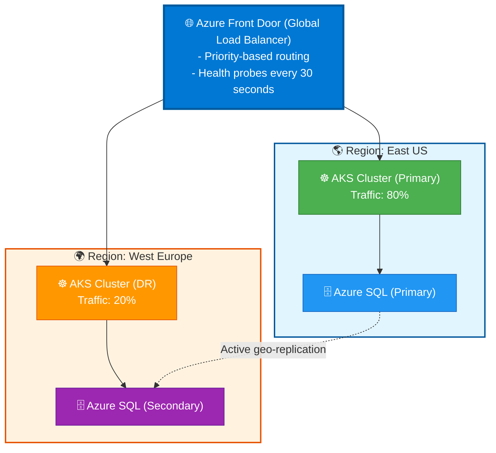

# Project Constitution — bolt-brown-app1

> **Project**: bolt-brown-app1
> **Generated**: 2026-11-05 15:40:00
> **Practice**: Apps & Infra
> **Active Scopes**: backend, frontend, cloud-platform
> **Project Type**: full-stack (brown)
> **Backend Stack Template**: dotnet-8
> **Cloud Provider**: Microsoft Azure (mandatory for all deployments)

This constitution is the **single source of truth** and contains only the articles explicitly approved during refinement.
Articles that appear in several scopes (VII, VIII, X, XI, XII, XIII, XVI, XVII, XIX) are merged into one section
and tagged with their originating scopes. The condensed view is `.boltf/memory/constitution.digest.md`.

---

## Article I: Active Scopes

- **backend**: .NET 8 modular monolith (C#)
- **frontend**: Angular 20 monolith SPA
- **cloud-platform**: Azure workload infrastructure with Terraform

---

## Article II: Application Configuration

**Criticality**: HIGH · **Scopes**: backend, frontend

### Section 2.1: Backend Language and Runtime (backend)

- Language: C# / .NET
- Version: .NET 8 (LTS), locked by the dotnet-8 template
- API style: Controllers (MVC)

### Section 2.2: Frontend Framework (frontend)

- Framework: Angular 20

### Section 2.3: Mobile Application (frontend)

- None

### Section 2.4: Design Tooling (frontend)

- None; HTML mockups only

---

## Article III: Application Architecture

**Criticality**: HIGH · **Scopes**: backend, frontend

### Section 3.1: Backend Architecture Style (backend)

- Modular Monolith

### Section 3.2: Frontend Architecture Style (frontend)

- Monolith SPA

### Section 3.3: CQRS Configuration (backend)

- CQRS enabled: Yes, pattern **Simple CQRS** with native .NET interfaces
- **NO MediatR**. Implement CQRS with native interfaces and DI-based dispatchers (no reflection magic)

```csharp
// Commands
public interface ICommand { }
public interface ICommandHandler<in TCommand> where TCommand : ICommand
{
    Task HandleAsync(TCommand command, CancellationToken ct = default);
}
public interface ICommandHandler<in TCommand, TResult> where TCommand : ICommand
{
    Task<TResult> HandleAsync(TCommand command, CancellationToken ct = default);
}

// Queries
public interface IQuery<TResult> { }
public interface IQueryHandler<in TQuery, TResult> where TQuery : IQuery<TResult>
{
    Task<TResult> HandleAsync(TQuery query, CancellationToken ct = default);
}

// Dispatchers (DI-based, no reflection magic)
public interface ICommandDispatcher
{
    Task DispatchAsync<TCommand>(TCommand command, CancellationToken ct = default)
        where TCommand : ICommand;
}
public interface IQueryDispatcher
{
    Task<TResult> DispatchAsync<TQuery, TResult>(TQuery query, CancellationToken ct = default)
        where TQuery : IQuery<TResult>;
}

// Domain Events
public interface IDomainEvent
{
    Guid EventId { get; }
    DateTime OccurredOn { get; }
}
public interface IDomainEventHandler<in TEvent> where TEvent : IDomainEvent
{
    Task HandleAsync(TEvent domainEvent, CancellationToken ct = default);
}
```

### Section 3.4: Event Sourcing (backend)

- Disabled

---

## Article IV: Communication

**Criticality**: HIGH · **Scope**: backend

- Style: Hybrid (synchronous and asynchronous)
- Synchronous: REST API
- Message broker: Azure Service Bus
- Background processing: .NET BackgroundService

---

## Article V: Data Storage

**Criticality**: HIGH · **Scope**: backend

- Primary database: PostgreSQL
- Data access: EF Core + Dapper
- Repository pattern: Yes
- Unit of Work pattern: Yes
- Migrations: EF Core Migrations

---

## Article VI: Caching Strategy

**Criticality**: MEDIUM · **Scope**: backend

- L1 in-memory (`IMemoryCache`): enabled, default TTL 5 minutes
- L2 distributed cache: disabled
- L3 CDN: disabled
- Cache pattern: Cache-Aside

---

## Article VII: Identity and Access Management

**Criticality**: HIGH (backend) / MEDIUM (frontend) · **Scopes**: backend, frontend

- Production identity provider: Microsoft Entra ID
- Development/testing identity provider: Mock IDP
- SPA frontend: Authorization Code + PKCE (enabled)
- Mobile app: Authorization Code + PKCE (not applicable, no mobile)
- Service-to-service: Client Credentials (enabled)
- Backend API: JWT Bearer (enabled)
- Authorization model: Policy-Based

---

## Article VIII: Containers and Orchestration

**Criticality**: HIGH · **Scopes**: backend, cloud-platform

- Container strategy: Docker
- Orchestration: Azure Container Apps
- Kubernetes configuration (Section 8.3): not applicable (no AKS/K8s)
- KEDA: enabled, scalers Azure Service Bus and HTTP Request count
- Dapr: disabled

---

## Article VIII-B: Infrastructure Scope and Landing Zone Strategy

**Criticality**: HIGH · **Scope**: cloud-platform

- Infrastructure scope: Workload Infrastructure (no Landing Zone)
- Workload resources:
  - Compute: Azure Container Apps and Azure Static Web Apps
  - Data: PostgreSQL and Storage Accounts (no Redis)
  - Integration: Azure Service Bus (no API Management, no Application Gateway)
  - Security: Key Vault, VNet and private endpoints
- Approach: modular, with shared Terraform modules plus per-environment configuration

---

## Article VIII-C: Service Orchestration with .NET Aspire

**Criticality**: MEDIUM · **Scope**: cloud-platform

- .NET Aspire is **not adopted**

---

## Article IX: Infrastructure as Code

**Criticality**: HIGH · **Scope**: cloud-platform

- IaC tool: Terraform
- Structure: `infra/terraform/modules` plus `infra/terraform/environments` (dev, pre, prod)

---

## Article X: Environments and Configuration

**Criticality**: MEDIUM · **Scopes**: backend, frontend, cloud-platform

| Environment | Enabled | Auto-Deploy |
| ----------- | ------- | ----------- |
| dev         | Yes     | Yes         |
| uat         | No      | -           |
| pre         | Yes     | Yes         |
| prod        | Yes     | Yes         |

- Configuration: `appsettings.{Environment}.json` (backend), Angular environment files (frontend), Terraform `tfvars` per environment (cloud-platform)
- Secrets: Azure Key Vault for connection strings, API keys and certificates; no secrets in the SPA bundle; local development uses User Secrets
- Feature flags: None

---

## Article XI: CI/CD Pipeline

**Criticality**: MEDIUM · **Scopes**: backend, frontend, cloud-platform

- Platform: GitHub Actions
- Backend stages: build (warnings as errors), lint-format, unit-tests (coverage >= 80%), integration-tests, architecture-tests, mutation-tests (score >= 60%), security-scan (0 Critical), container-build, container-scan (0 Critical)
- Frontend stages: build, lint-format, unit-tests (coverage >= 80%), integration-tests, mutation-tests (score >= 60%), security-scan (0 Critical), container-build, container-scan
- Infrastructure stages: iac-lint, iac-validation, security-scan, cost-estimation, compliance-check
- Deployment stages: deploy-dev, deploy-pre, deploy-prod
- Deployment strategy: Rolling Update
- Branch strategy: GitHub Flow (see `.boltf/docs/branching-strategy.md`)

---

## Article XII: Observability

**Criticality**: MEDIUM · **Scopes**: backend, frontend, cloud-platform

- Strategy: OpenTelemetry to Azure
- Health checks: `/health`, `/health/ready`, `/health/live`
- Infrastructure monitoring: resource-health, activity-logs

---

## Article XIII: Testing Standards

**Criticality**: HIGH (backend) / MEDIUM (frontend, cloud-platform) · **Scopes**: backend, frontend, cloud-platform

### Section 13.1: Thresholds (backend and frontend)

- Line coverage >= 80%
- Mutation score >= 60% (overrides the template default of 70%)

### Section 13.2: Frameworks

| Layer                  | Frameworks                                                                              |
| ---------------------- | --------------------------------------------------------------------------------------- |
| Backend (.NET)         | xUnit; xUnit + Testcontainers; NetArchTest; Reqnroll; Playwright; k6; mutation: Stryker.NET |
| Frontend (Angular)     | Jest; Testing Library (Angular); Playwright (E2E and visual regression); Lighthouse CI / Web Vitals; mutation: Stryker Mutator |

### Section 13.3: Backend Test Project Structure

```text
tests/
├── {Module}.UnitTests/
├── {Module}.IntegrationTests/
├── Architecture.Tests/
├── E2E.Tests/
└── Common.Tests/
    ├── Fixtures/
    ├── Fakes/
    └── Builders/
```

### Section 13.4: Infrastructure Testing (cloud-platform)

| Test Type         | Tool                   | Purpose                    |
| ----------------- | ---------------------- | -------------------------- |
| IaC Lint          | Bicep linter / tflint  | Syntax and best practices  |
| Security Scan     | Checkov / tfsec        | Security misconfigurations |
| Policy Compliance | Azure Policy (what-if) | Governance validation      |
| Integration Test  | Pester / Terratest     | Post-deployment validation |
| Cost Estimation   | Infracost              | Budget validation          |

---

## Article XIV: Code Standards

**Criticality**: LOW · **Scopes**: backend, frontend

### Section 14.1: Backend (C#)

- PascalCase for types, members and namespaces; interfaces prefixed with `I`; private fields `_camelCase`; `Async` suffix on async methods

### Section 14.2: Backend Formatting

- 4 spaces, 120 characters, file-scoped namespaces, nullable reference types enabled, `.editorconfig` + `dotnet format`

### Section 14.3: Frontend Naming

- Files kebab-case; classes and components PascalCase; functions and variables camelCase; constants UPPER_SNAKE_CASE

### Section 14.4: Frontend Formatting

- 2 spaces, 100 characters, semicolons, single quotes, ESLint + Prettier

---

## Article XIV-B: FinOps & Cost Management

> **📋 Applies to**: ALL Azure projects (Infrastructure and Application teams)
> **⏭️ Skip if**: POC/demo projects with no budget constraints
> **References**: [FinOps on Azure (Microsoft)](https://learn.microsoft.com/azure/cost-management-billing/finops/)

**FinOps** (Financial Operations) is a cultural practice that brings financial accountability to cloud spending through collaboration between Finance, Engineering, and Business teams.

### Section 14B.1: FinOps Team Structure

**Roles & Responsibilities**:

| Role                  | Responsibility                                       | Stakeholder      |
| --------------------- | ---------------------------------------------------- | ---------------- |
| **FinOps Lead**       | Define cost policies, review budgets, cost reporting | Finance/IT       |
| **Engineering Teams** | Tag resources, optimize workloads, forecast capacity | DevOps/Eng       |
| **Product Owners**    | Prioritize cost vs features, approve spending        | Product/Business |
| **Executives**        | Set budget constraints, approve reservations         | C-Level          |

**Recommended Team Size**: 1 FinOps Lead per 20-50 engineers.

### Section 14B.2: Cost Visibility & Tagging Strategy

**Mandatory Tags** (enforced via Azure Policy):

| Tag           | Purpose                        | Example           |
| ------------- | ------------------------------ | ----------------- |
| `Environment` | Separate dev/uat/prod costs    | `prod`            |
| `CostCenter`  | Chargeback to business unit    | `marketing`       |
| `Owner`       | Team responsible for resources | `platform-team`   |
| `Application` | Group resources by app         | `customer-portal` |
| `Project`     | Track project budgets          | `project-phoenix` |

**Azure Policy Tag Enforcement**:

```bicep
// Bicep: Require tags on resource groups
resource tagPolicy 'Microsoft.Authorization/policyAssignments@2023-04-01' = {
  name: 'enforce-tags'
  properties: {
    policyDefinitionId: '/providers/Microsoft.Authorization/policyDefinitions/96670d01-0a4d-4649-9c89-2d3abc0a5025'
    parameters: {
      tagName: {
        value: 'CostCenter'
      }
    }
  }
}
```

### Section 14B.3: Budgets & Alerts

**Budget Configuration**:

- [ ] **Per Subscription** - Total spend cap per environment
- [ ] **Per Resource Group** - Budget per application/team
- [ ] **Per Tag** - Track spending by cost center/project

**Alert Thresholds** (Azure Cost Management):

| Threshold          | Action                     | Recipient                |
| ------------------ | -------------------------- | ------------------------ |
| **50% of budget**  | Email alert                | FinOps Lead + Team Lead  |
| **80% of budget**  | Email + Teams notification | Team + Product Owner     |
| **100% of budget** | Escalation                 | Executives + FinOps Lead |

**Example**:

```bash
# Create budget via Azure CLI
az consumption budget create \
  --budget-name "project-phoenix-monthly" \
  --amount 5000 \
  --time-grain Monthly \
  --start-date 2024-01-01 \
  --end-date 2024-12-31 \
  --resource-group "rg-project-phoenix" \
  --notifications "Actual_GreaterThan_80_Percent"={enabled:true,operator:GreaterThan,threshold:80,contactEmails:[team@example.com]}
```

### Section 14B.4: Cost Optimization Opportunities

**Compute Optimization**:

- [ ] **Azure Reservations** - 1-year or 3-year commitment (up to 72% savings on VMs, SQL)
- [ ] **Spot VMs** - Interruptible workloads (up to 90% discount for non-prod, batch jobs)
- [ ] **Auto-shutdown schedules** - Stop dev/uat VMs outside business hours
- [ ] **Right-sizing** - Analyze CPU/memory utilization, downgrade underutilized VMs
- [ ] **Azure Hybrid Benefit** - Use existing Windows Server/SQL licenses (save 40-49%)

**Storage Optimization**:

- [ ] **Tiering** - Move cold data to Cool/Archive tiers (up to 80% cheaper)
- [ ] **Lifecycle policies** - Auto-transition blobs to lower-cost tiers
- [ ] **Delete unused disks** - Orphaned managed disks from deleted VMs
- [ ] **Geo-redundancy review** - Downgrade from GRS to LRS if not needed

**Database Optimization**:

- [ ] **Serverless Azure SQL** - Auto-pause during inactivity (dev/uat databases)
- [ ] **Reserved Capacity** - 1-year/3-year for prod databases (up to 65% savings)
- [ ] **Elastic Pools** - Share resources across multiple databases

**Networking Optimization**:

- [ ] **Review NAT Gateway usage** - $0.045/hour + data processing fees
- [ ] **Consolidate Public IPs** - $0.005/hour per IP ($3.65/month)
- [ ] **ExpressRoute commitment** - Reservations for predictable bandwidth

### Section 14B.5: Azure Advisor Cost Recommendations

**Azure Advisor** provides automated cost optimization recommendations:

- Idle VMs (low CPU/memory usage) → Resize or delete
- Unattached disks → Delete orphaned managed disks
- Reserved Instances recommendations → Save 30-70% on predictable workloads
- ExpressRoute circuits with low bandwidth usage → Downgrade SKU

**Implementation**:

```bash
# Get Advisor recommendations via Azure CLI
az advisor recommendation list --category Cost --output table

# Example automation: Auto-shutdown idle VMs
az vm auto-shutdown -g rg-dev -n vm-dev-01 --time 1800  # 6 PM daily
```

### Section 14B.6: FinOps Metrics & KPIs

**Track Monthly**:

| Metric                         | Formula                                           | Target                |
| ------------------------------ | ------------------------------------------------- | --------------------- |
| **Cost per Customer**          | Total Cost / # Active Customers                   | Decreasing trend      |
| **Cost per Transaction**       | Total Cost / # Transactions                       | < $0.10               |
| **Cloud Spend Growth Rate**    | (Current Month - Previous Month) / Previous Month | < Revenue Growth Rate |
| **Waste Percentage**           | (Idle Resources Cost) / Total Cost                | < 10%                 |
| **Reserved Instance Coverage** | Reserved Cost / Total Eligible Cost               | > 70% for prod        |

**Dashboard**: Use Azure Cost Management Power BI connector or Grafana.

### Section 14B.7: Commitment-Based Discounts

**Azure Reservations**:

- **1-year term**: 20-40% discount
- **3-year term**: 40-72% discount
- **Applicable to**: VMs, SQL Database, Cosmos DB, App Service, Data Factory

**Purchasing Strategy**:

- Analyze last 6 months of usage (Azure Advisor recommendations)
- Purchase Reservations for **stable prod workloads** only (not dev/uat)
- Start with 1-year commitments, upgrade to 3-year after validating stability

**Example**:

```bash
# Purchase 1-year VM reservation
az reservations reservation-order purchase \
  --reservation-order-id "/providers/Microsoft.Capacity/reservationOrders/..." \
  --sku "Standard_D2s_v3" \
  --location "eastus" \
  --quantity 10 \
  --term P1Y  # 1 year
```

### Section 14B.8: Chargeback & Showback

**Showback** - Inform teams of their costs (no billing):

- Monthly reports per team/application/cost center
- Use Azure Cost Management workbooks

**Chargeback** - Bill teams for actual consumption:

- Requires Finance approval and internal billing system
- Use tags (CostCenter, Application) to allocate costs
- Export cost data to ERP/billing system via Azure Cost Management API

**Implementation**:

```powershell
# Export cost data for chargeback
az costmanagement query `
  --type Usage `
  --dataset-filter "{\"and\":[{\"dimensions\":{\"name\":\"ResourceGroup\",\"operator\":\"In\",\"values\":[\"rg-marketing\"]}}]}" `
  --timeframe MonthToDate `
  --dataset-aggregation "{\"totalCost\":{\"name\":\"Cost\",\"function\":\"Sum\"}}"
```

### Section 14B.9: FinOps Automation

**Automated Actions**:

- [ ] **Auto-shutdown dev/uat VMs** - Azure Automation runbooks
- [ ] **Delete unattached disks** - Weekly Azure Function
- [ ] **Move blobs to Archive tier** - Lifecycle policies
- [ ] **Alert on budget overruns** - Action Groups → Logic Apps → Teams/Slack

**Example Azure Function (Delete Orphaned Disks)**:

```csharp
[FunctionName("DeleteOrphanedDisks")]
public static async Task Run([TimerTrigger("0 0 2 * * 0")] TimerInfo timer, ILogger log) {
    var disks = await GetUnattachedDisks();
    foreach (var disk in disks) {
        if (disk.IdleDays > 30) {
            await DeleteDisk(disk.Id);
            log.LogInformation($"Deleted orphaned disk: {disk.Name}");
        }
    }
}
```

---

## Article XIV-C: SRE & Reliability Engineering

> **📋 Applies to**: Production applications, business-critical systems
> **⏭️ Skip if**: Internal tools, prototypes, dev-only environments
> **References**: [SRE with Azure (Microsoft)](https://learn.microsoft.com/azure/architecture/framework/devops/principles)

**Site Reliability Engineering (SRE)** ensures systems are reliable, scalable, and maintainable through engineering practices: SLOs, error budgets, toil reduction, and incident management.

### Section 14C.1: Service Level Objectives (SLOs)

**SLI → SLO → SLA Hierarchy**:

- **SLI** (Service Level Indicator) - Quantitative measure (e.g., request success rate, latency p95)
- **SLO** (Service Level Objective) - Internal target (e.g., 99.9% success rate)
- **SLA** (Service Level Agreement) - External commitment with penalties (e.g., 99.95% uptime)

**SLO Definition**:

| Service     | SLI                         | SLO Target | Measurement Window    |
| ----------- | --------------------------- | ---------- | --------------------- |
| API Gateway | Success rate (HTTP 2xx/3xx) | 99.9%      | 30-day rolling window |
| Web App     | Latency p95                 | < 500ms    | 30-day rolling window |
| Database    | Availability                | 99.95%     | 30-day rolling window |

**SLO Formula**:

```text
SLO = (Good Events / Total Events) × 100%

Example:
- Total requests: 1,000,000
- Failed requests (5xx): 500
- Success rate: (999,500 / 1,000,000) × 100% = 99.95% ✅ (meets 99.9% SLO)
```

### Section 14C.2: Error Budgets

**Error Budget** - Allowable downtime/failures before SLO is violated.

**Calculation**:

```text
Error Budget = 100% - SLO

Example (99.9% SLO over 30 days):
- Allowable downtime: 0.1% × 30 days = 0.03 days = 43 minutes
- If actual downtime = 20 minutes → 23 minutes remaining
- If actual downtime = 50 minutes → Budget exceeded ❌
```

**Policy** (when error budget exhausted):

- [ ] **Freeze feature releases** - Focus on reliability improvements only
- [ ] **Mandatory postmortem** - Root cause analysis required
- [ ] **Prioritize reliability backlog** - Fix known issues before new features
- [ ] **Executive escalation** - Inform leadership of reliability breach

**Monitoring Error Budgets**:

```kusto
// Azure Monitor KQL: Calculate error budget consumption
requests
| where timestamp > ago(30d)
| summarize
    TotalRequests = count(),
    FailedRequests = countif(resultCode >= 500)
| extend
    SuccessRate = (TotalRequests - FailedRequests) * 100.0 / TotalRequests,
    SLO = 99.9,
    ErrorBudgetConsumed = 100 - SuccessRate,
    ErrorBudgetRemaining = SLO - (100 - SuccessRate)
| project SuccessRate, ErrorBudgetConsumed, ErrorBudgetRemaining
```

### Section 14C.3: Toil Reduction

**Toil** - Manual, repetitive, automatable work that doesn't add long-term value.

**Examples of Toil**:

- Manually restarting crashed services
- Manual deployment steps (copy-paste commands)
- Ticket-driven provisioning (create VM, create database)
- Manual log analysis for known issues

**Toil Reduction Strategies**:

- [ ] **Automate incident response** - Auto-restart failed pods (Kubernetes liveness probes)
- [ ] **Self-service infrastructure** - Developers provision via IaC (Terraform, Bicep)
- [ ] **Automate monitoring alerts** - Azure Monitor Action Groups → runbooks
- [ ] **Reduce alert noise** - Consolidate duplicate alerts, use smart grouping

**Goal**: Limit toil to < 50% of engineer time (Google SRE guideline).

### Section 14C.4: Incident Management

**Incident Severity Levels**:

| Severity             | Definition                           | Response Time     | Escalation                       |
| -------------------- | ------------------------------------ | ----------------- | -------------------------------- |
| **SEV-1 (Critical)** | Complete service outage, data loss   | < 15 minutes      | Immediate executive notification |
| **SEV-2 (High)**     | Degraded performance, partial outage | < 1 hour          | On-call engineer + manager       |
| **SEV-3 (Medium)**   | Minor impact, workaround available   | < 4 hours         | Standard on-call rotation        |
| **SEV-4 (Low)**      | No user impact, cosmetic issues      | Next business day | Backlog prioritization           |

**Incident Response Process**:

1. **Detection** - Automated alert (Azure Monitor) or user report
2. **Triage** - On-call engineer assesses severity
3. **Mitigation** - Quick fix (rollback, scale up, restart service)
4. **Resolution** - Root cause fix deployed
5. **Postmortem** - Blameless analysis within 5 business days (SEV-1/2)

**On-Call Rotation**:

- [ ] **Follow-the-sun** - Rotate across time zones (24/7 coverage)
- [ ] **Primary + Secondary** - Escalation path if primary unavailable
- [ ] **On-call compensation** - Stipend or time-off for on-call duty

### Section 14C.5: Postmortem Process

**Blameless Postmortem** - Focus on systems, not individuals.

**Template**:

```markdown
# Incident Postmortem: [Date] - [Service] Outage

## Summary

- **Incident Date**: 2024-02-27
- **Duration**: 45 minutes
- **Severity**: SEV-1
- **Impact**: 100% of users unable to access API

## Timeline

| Time  | Event                                          |
| ----- | ---------------------------------------------- |
| 14:00 | Deploy v1.2.3 to production                    |
| 14:05 | Alerts: HTTP 500 errors spike to 100%          |
| 14:10 | On-call engineer paged                         |
| 14:15 | Identified: database connection pool exhausted |
| 14:20 | Mitigation: Rolled back to v1.2.2              |
| 14:30 | Service restored, error rate < 0.1%            |

## Root Cause

Database connection leak introduced in v1.2.3 (missing `.Dispose()` call).

## Action Items

| Action                                                | Owner          | Deadline   |
| ----------------------------------------------------- | -------------- | ---------- |
| Add connection leak test to CI pipeline               | @jane          | 2024-03-05 |
| Increase connection pool size (short-term mitigation) | @john          | 2024-02-28 |
| Implement connection pool monitoring                  | @platform-team | 2024-03-10 |

## Lessons Learned

- ✅ **What went well**: Rollback executed quickly (10 minutes)
- ❌ **What went poorly**: No automated rollback on error rate spike
- 🔧 **Improvement**: Enable auto-rollback in deployment pipeline
```

### Section 14C.6: Chaos Engineering

**Chaos Engineering** - Intentionally inject failures to test system resilience.

**Tools**:

- [ ] **Azure Chaos Studio** - Managed service for Azure resources
- [ ] **Chaos Mesh** - Kubernetes chaos experiments
- [ ] **Gremlin** - SaaS chaos engineering platform

**Example Experiments**:

- **Kill random pods** - Test Kubernetes auto-recovery
- **Introduce network latency** - Validate timeout handling
- **Simulate AZ failure** - Test multi-zone resilience
- **Database failover** - Validate connection retry logic

**Implementation (Azure Chaos Studio)**:

```bash
# Create experiment: Kill 50% of pods in namespace
az chaos experiment create \
  --name "kill-pods-experiment" \
  --resource-group "rg-chaos" \
  --experiment-file chaos-experiment.json

# chaos-experiment.json
{
  "steps": [{
    "name": "kill-pods",
    "branches": [{
      "name": "kill-branch",
      "actions": [{
        "type": "continuous",
        "duration": "PT5M",  # 5 minutes
        "parameters": [{
          "key": "podKillPercentage",
          "value": "50"
        }],
        "selectorId": "aks-cluster-selector"
      }]
    }]
  }]
}
```

### Section 14C.7: Capacity Planning

**Capacity Management** - Ensure sufficient resources for current + future demand.

**Forecast Methods**:

- [ ] **Trend Analysis** - Extrapolate from historical growth (linear, exponential)
- [ ] **Business-Driven** - Product roadmap (new features, customer launches)
- [ ] **Load Testing** - Determine breaking point, plan for 2x safety margin

**Capacity Metrics to Track**:

| Resource | Metric          | Warning Threshold | Critical Threshold |
| -------- | --------------- | ----------------- | ------------------ |
| CPU      | Utilization     | > 70%             | > 85%              |
| Memory   | Utilization     | > 75%             | > 90%              |
| Disk     | IOPS usage      | > 80%             | > 95%              |
| Database | DTU/vCore usage | > 70%             | > 85%              |

**Auto-Scaling Strategy**:

- [ ] **Horizontal (Scale Out)** - Add more pods/VMs (preferred for stateless apps)
- [ ] **Vertical (Scale Up)** - Increase VM size (for stateful databases)
- [ ] **Scheduled Scaling** - Pre-scale before known traffic spikes (Black Friday)

---

## Article XIV-D: Disaster Recovery & Business Continuity

> **📋 Applies to**: Production systems, business-critical applications
> **⏭️ Skip if**: Non-production environments, disposable resources
> **References**: [Azure Business Continuity (Microsoft)](https://learn.microsoft.com/azure/reliability/overview)

**Disaster Recovery (DR)** ensures business operations continue after catastrophic failures (region outage, data center failure, ransomware).

### Section 14D.1: Recovery Objectives

**Define DR Requirements**:

| Metric                                   | Definition                     | Typical Values                             | Approval       |
| ---------------------------------------- | ------------------------------ | ------------------------------------------ | -------------- |
| **RPO** (Recovery Point Objective)       | Max acceptable data loss       | 1 hour, 15 min, 0 (sync replication)       | Business Owner |
| **RTO** (Recovery Time Objective)        | Max acceptable downtime        | 4 hours, 1 hour, < 5 min                   | Business Owner |
| **RCO** (Recovery Consistency Objective) | Data consistency after restore | Eventually consistent, strongly consistent | Tech Lead      |

**Cost vs Tolerance**:

```text
Higher Availability = Higher Cost

RPO 0, RTO < 5 min → Active-Active multi-region ($$$$)
RPO 1 hour, RTO 4 hours → Backup + warm standby ($$$)
RPO 24 hours, RTO 24 hours → Cold standby ($)
```

### Section 14D.2: DR Strategies

Select ONE per application tier:

#### Strategy 1: Backup & Restore (Lowest Cost)

- **RPO**: 1-24 hours
- **RTO**: 4-24 hours
- **Cost**: $
- **Implementation**: Automated backups to geo-redundant storage
- **Use case**: Non-critical applications, dev/uat environments

#### Strategy 2: Pilot Light (Warm Standby)

- **RPO**: 15 minutes - 1 hour
- **RTO**: 1-4 hours
- **Cost**: $$
- **Implementation**: Minimal DR site (database replicas, scaled-down compute), scale up on failover
- **Use case**: Business applications with moderate RTO requirements

#### Strategy 3: Warm Standby (Active-Passive)

- **RPO**: < 15 minutes
- **RTO**: < 1 hour
- **Cost**: $$$
- **Implementation**: Fully provisioned DR site (50-100% capacity), auto-failover configured
- **Use case**: High-availability applications, customer-facing services

#### Strategy 4: Active-Active (Multi-Region)

- **RPO**: 0 (continuous replication)
- **RTO**: < 5 minutes (automatic failover)
- **Cost**: $$$$
- **Implementation**: Traffic split across regions, data synced bi-directionally
- **Use case**: Mission-critical systems, SLA > 99.99%

### Section 14D.3: Azure DR Capabilities by Service

| Service                | DR Capability                      | Configuration                                            |
| ---------------------- | ---------------------------------- | -------------------------------------------------------- |
| **Azure SQL Database** | Active geo-replication             | Secondary replica in paired region, auto-failover groups |
| **Azure Cosmos DB**    | Multi-region writes                | Enable multi-region replication, automatic failover      |
| **Azure Storage**      | GRS (Geo-Redundant Storage)        | Data replicated to paired region, 15-min RPO             |
| **Azure VM**           | Azure Site Recovery (ASR)          | Replicate VMs to secondary region, orchestrated failover |
| **AKS**                | Multi-cluster + Traffic Manager    | Deploy to 2+ regions, use Azure Front Door for routing   |
| **App Service**        | Traffic Manager + Deployment Slots | Primary + secondary region, DNS-based failover           |

### Section 14D.4: Backup Strategy

**Backup Frequency**:

| Data Type                | Backup Frequency        | Retention              | Storage              |
| ------------------------ | ----------------------- | ---------------------- | -------------------- |
| **Databases**            | Hourly transaction logs | 35 days (prod)         | GRS (Azure Backup)   |
| **File Storage**         | Daily snapshots         | 30 days                | ZRS/GRS (Azure Blob) |
| **Infrastructure (IaC)** | On every commit         | Indefinite (Git)       | GitHub/Azure Repos   |
| **Secrets**              | Manual export quarterly | Offline secure storage | Key Vault + HSM      |

**Azure Backup Configuration**:

```bash
# Enable automated backups for Azure SQL
az sql db show --resource-group rg-prod --server sql-prod --name db-app --query "retentionDays"
# Default: 7 days, max 35 days

# Create backup policy for VMs (Azure Site Recovery)
az backup policy create \
  --resource-group rg-backup \
  --vault-name vault-prod \
  --policy '{
    "name": "DailyBackupPolicy",
    "schedulePolicy": {
      "scheduleRunFrequency": "Daily",
      "scheduleRunTimes": ["2024-02-27T02:00:00Z"]
    },
    "retentionPolicy": {
      "dailySchedule": { "retentionDuration": { "count": 30, "durationType": "Days" } }
    }
  }'
```

### Section 14D.5: Failover Testing

**DR Drills** - Test failover procedures quarterly (SEV-1 systems) or annually (SEV-2/3).

**Test Plan**:

1. **Announce drill** - Schedule during low-traffic window, notify stakeholders
2. **Trigger failover** - Execute failover to DR region (manual or automated)
3. **Validate services** - Check all components functional in DR site
4. **Measure RTO** - Record actual failover time vs target
5. **Fail back** - Return to primary region (if applicable)
6. **Document results** - Update runbooks with lessons learned

**Azure SQL Failover Test**:

```bash
# Trigger failover to secondary region (Azure SQL Failover Group)
az sql failover-group set-primary \
  --name sql-failover-group \
  --resource-group rg-prod \
  --server sql-prod-secondary

# Verify new primary
az sql failover-group show --name sql-failover-group --resource-group rg-prod --server sql-prod-secondary
```

### Section 14D.6: Multi-Region Architecture

**Active-Active Pattern** (Azure Front Door + multiple AKS clusters):



**Failover Logic**:

- If primary region health < 50% → Route 100% traffic to secondary
- If primary region restored → Gradual traffic shift (20% → 50% → 80%)

### Section 14D.7: Runbook for Disaster Recovery

**Runbook Template**:

````markdown
# DR Runbook: [Service Name]

## Pre-Requisites

- Access to Azure Portal with Contributor role
- PagerDuty/on-call access
- Incident communication channel (Teams/Slack)

## Failover Steps

### 1. Assess Impact

- Check Azure Service Health: https://status.azure.com/
- Verify primary region health (Azure Monitor dashboard)
- Estimate RPO data loss (query last replicated transaction timestamp)

### 2. Declare Incident

- Create SEV-1 incident in PagerDuty
- Notify: Engineering Lead, Product Owner, Customer Support

### 3. Execute Failover

```bash
# Azure SQL failover
az sql failover-group set-primary --name sql-fg --resource-group rg-dr --server sql-dr

# AKS traffic shift (Azure Front Door)
az network front-door routing-rule update --name default-rule --front-door-name fd-global --resource-group rg-global --backend-pool pool-dr

# Verify services
curl https://api.example.com/health
```
````

### 4. Validate Services

- [ ] API health check returns 200 OK
- [ ] Database connections successful
- [ ] Background jobs running
- [ ] Monitoring dashboards show green metrics

### 5. Communicate Status

- Post to status page: "Failover to DR region completed. Services restored."
- Notify customers if SLA breach occurred

### 6. Postmortem

- Schedule postmortem within 3 business days
- Update runbook with lessons learned


---

## Article XV: Project Structure Templates

**Criticality**: LOW · **Scopes**: backend, cloud-platform

### Template A: C# + Modular Monolith (backend)

```text
project-root/
├── src/
│   ├── Modules/
│   │   ├── Orders/
│   │   │   ├── Orders.Domain/
│   │   │   ├── Orders.Application/
│   │   │   ├── Orders.Infrastructure/
│   │   │   └── Orders.Api/
│   │   └── Users/
│   ├── Shared/
│   │   ├── SharedKernel/
│   │   │   └── CQRS/           # Native interfaces
│   │   └── Contracts/
│   └── Api.Host/
├── tests/
│   ├── Orders.UnitTests/
│   ├── Orders.IntegrationTests/
│   └── Architecture.Tests/
├── infra/
│   └── terraform/
├── Directory.Build.props
└── Directory.Packages.props
```

### Template F: Infrastructure Only - Workload (cloud-platform)

Template E (Landing Zone) is excluded. The IaC tool is Terraform, so the Terraform variant of the template applies.

```text
project-root/
├── infra/
│   ├── terraform/
│   │   ├── modules/
│   │   │   ├── networking/
│   │   │   ├── compute/        # container-apps, static-web-app
│   │   │   ├── data/           # postgresql, storage
│   │   │   └── security/       # keyvault, managed-identity
│   │   └── environments/
│   │       ├── dev/
│   │       ├── pre/
│   │       └── prod/
├── tests/
│   ├── lint/
│   ├── security/
│   └── post-deploy/
├── pipelines/
│   └── infra-deploy.yml
├── docs/
│   └── architecture.md
└── README.md
```

---

## Article XVI: Security Policies

**Criticality**: MEDIUM · **Scopes**: backend, frontend, cloud-platform

- Network: Azure VNet; Private Endpoints enabled; no WAF
- Data protection: Azure-managed keys; TLS 1.2+; PII handling by encryption
- Compliance: GDPR required; HIPAA, SOC 2 and PCI-DSS not required

---

## Article XVII: Legacy and Migration

**Criticality**: MEDIUM · **Scopes**: backend, frontend

- Migration context: Brownfield (legacy source in `legacy/`)
- Migration strategy: Strangler Fig

---

## Article XVIII: API Management

**Criticality**: MEDIUM · **Scope**: backend

- API gateway: None (direct access; modular monolith)
- Rate limiting: No
- API versioning: Yes, URL strategy
- OpenAPI/Swagger: Yes
- AsyncAPI: Yes (hybrid communication)

---

## Article XIX: Governance

**Criticality**: LOW · **Scopes**: backend, frontend, cloud-platform

### Section 19.1: Constitution Amendments

1. **Proposal**: Any team member may propose amendments
2. **Review**: Tech Lead + Architect review required
3. **Approval**: Majority approval from signatories
4. **Implementation**: Update constitution + notify AI agents
5. **Versioning**: Semantic versioning (MAJOR.MINOR.PATCH)

### Section 19.2: AI Agent Compliance

All AI agents operating in this project MUST:

1. **Read** the constitution (digest first) before any operation
2. **Validate** all decisions against constitution principles
3. **FAIL** operations that violate the constitution
4. **Request** amendment for justified exceptions
5. **Log** all constitution checks for audit

---

## Frontend Additions (ADD)

**Criticality**: LOW · **Scope**: frontend

- Accessibility (WCAG 2.2): enforced via axe-core + Playwright accessibility audits
- Performance budgets: Lighthouse CI in pipelines; Core Web Vitals via Azure Application Insights RUM
- Static hosting: Azure Static Web Apps; Azure CDN / Front Door for distribution
- Client-side error tracking: Azure Application Insights JavaScript SDK
- Excluded: Fluent UI (React/Blazor only), PWA support

---

## Provisioned Skills

No individual skill folders exist under `.boltf/available-skills` (it only holds category READMEs), so nothing was copied to `.claude/skills/`.
The relevant skills are delivered by the installed plugins and are auto-discovered:

- Backend: `dotnet-backend-patterns`, `backend-testing-dotnet`
- Frontend: `angular-primeng-frontend`, `skill-playwright-e2e`
- Cloud: `azure-identity-dotnet`, `azure-role-selector`, `azure-usage`, `skill-environment-configuration-strategy`, `skill-observability-azure`, `skill-security-policies-azure`, `skill-senior-devops`, `skill-cicd-pipeline-azure`
- Process: `skill-tdd-red-green-refactor`, `skill-characterization-testing`, `skill-bolt-branch-management`

---

## Constitution Metadata

- **Generated**: 2026-11-05 15:40:00
- **Source**: Merged refinement from 3 scopes
- **Articles Included**: 43
- **Articles Excluded**: 1 (Article XIV GitOps & Declarative Deployment)
- **Total Reviewed**: 44

*Only articles with decision='include' or decision='modified' are present in this constitution.*
