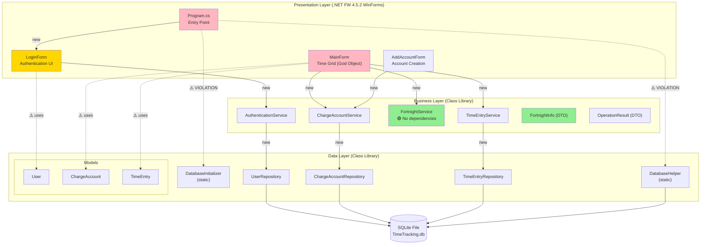
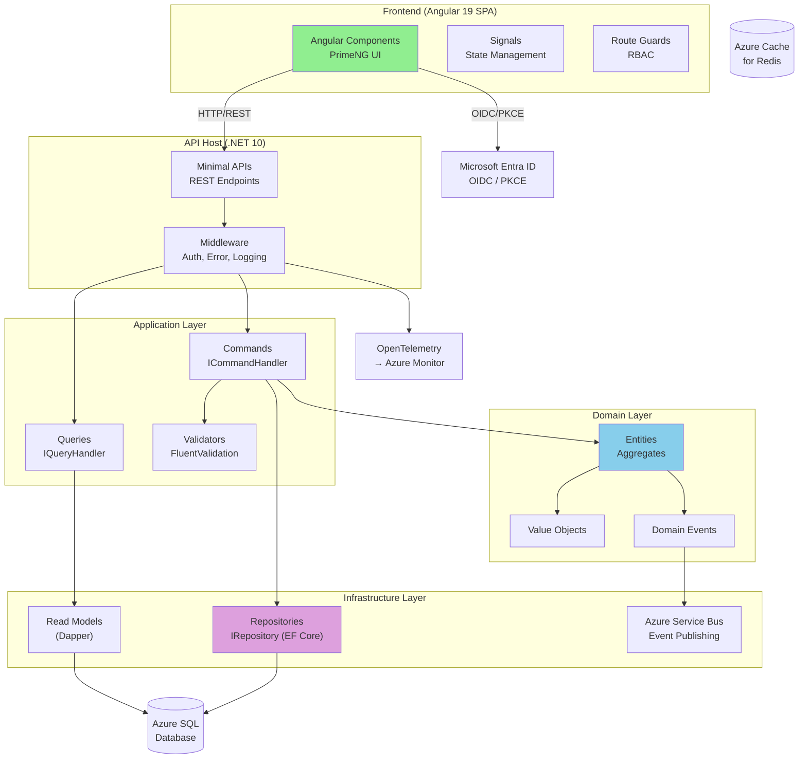

# Legacy Architecture Patterns Analysis

> **Date:** 2026-04-28
> **Scope:** `legacy/TimeTracking.Business/` and `legacy/TimeTracking.Presentation/`
> **Methodology:** Bolt Framework — DISCOVERY Phase (Brownfield Architecture Review)
> **Reference:** Constitution v1.0.0 (2026-03-23)

---

## Table of Contents

- [Executive Summary](#executive-summary)
- [1. Layer Separation Analysis](#1-layer-separation-analysis)
- [2. Dependency Injection Analysis](#2-dependency-injection-analysis)
- [3. Data Access Pattern Analysis](#3-data-access-pattern-analysis)
- [4. UI Pattern Analysis](#4-ui-pattern-analysis)
- [5. Error Handling and Validation Analysis](#5-error-handling-and-validation-analysis)
- [Pattern Gap Matrix — Legacy vs Constitution](#pattern-gap-matrix--legacy-vs-constitution)
- [Architecture Diagram — Legacy (AS-IS)](#architecture-diagram--legacy-as-is)
- [Architecture Diagram — Target (TO-BE)](#architecture-diagram--target-to-be)
- [Migration Risk Assessment](#migration-risk-assessment)
- [Recommendations](#recommendations)

---

## Executive Summary

The legacy system follows a **traditional 3-tier architecture** (Presentation → Business →
Data) implemented as a **.NET Framework 4.5.2 WinForms desktop application** with **SQLite**
persistence. While layers exist as separate projects, the boundaries are **porous** — the
Presentation layer reaches directly into `TimeTracking.Data.Models`, and Business services
instantiate concrete repositories via `new`.

The constitution mandates a fundamentally different architecture: **Modular Monolith** with
**Clean Architecture** per module, **CQRS**, **Angular SPA frontend**, **Azure SQL**, and
**interface-based DI**. This represents a **complete architectural transformation**, not an
incremental refactor.

**Gap severity: 🔴 CRITICAL** — No legacy architectural pattern survives unchanged into the
target architecture.

---

## 1. Layer Separation Analysis

### Legacy Structure (AS-IS)

```text
TimeTracking.sln
├── TimeTracking.Presentation  (.NET FW 4.5.2, WinExe)
│   ├── References → TimeTracking.Business
│   ├── References → TimeTracking.Data        ← ⚠️ VIOLATION
│   └── References → TimeTracking.Data.Models  ← ⚠️ VIOLATION
├── TimeTracking.Business       (.NET FW 4.5.2, Library)
│   └── References → TimeTracking.Data
└── TimeTracking.Data           (.NET FW 4.5.2, Library)
    ├── Repositories (UserRepository, ChargeAccountRepository, etc.)
    ├── Models (User, ChargeAccount, TimeEntry)
    ├── DatabaseHelper (SQLite connection management)
    └── DatabaseInitializer (seeding)
```

### Findings

| Aspect | Status | Detail |
| --- | --- | --- |
| Layers exist as separate projects | ✅ Yes | 3 projects: Presentation, Business, Data |
| Layer dependencies are unidirectional | 🟠 Partial | Business → Data is correct; **Presentation → Data is a violation** |
| Models are shared across all layers | ⚠️ Violation | `TimeTracking.Data.Models` is referenced directly from Presentation |
| Business layer has no interfaces | 🔴 No | No contracts — consumers depend on concrete classes |
| Data layer has no abstraction | 🔴 No | Concrete repositories with no interface definitions |

### Layer Boundary Violations

**1. Presentation → Data direct reference**

```csharp
// LoginForm.cs — imports Data.Models directly
using TimeTracking.Data.Models;

// Program.cs — calls Data layer directly, bypassing Business
using TimeTracking.Data;
DatabaseHelper.InitializeDatabase();
DatabaseInitializer.SeedData();
```

The Presentation layer references `TimeTracking.Data` directly in two ways:

- `Program.cs` calls `DatabaseHelper.InitializeDatabase()` and `DatabaseInitializer.SeedData()`
  (infrastructure concerns leaked into entry point)
- Forms use `TimeTracking.Data.Models.User`, `ChargeAccount`, `TimeEntry` directly (no DTOs or
  view models)

**2. No DTO/ViewModel boundary**

Domain models (`User`, `ChargeAccount`, `TimeEntry`) flow from the data layer through business
and into the UI without transformation. The Presentation layer binds directly to persistence
entities.

### Constitution Target (TO-BE)

The constitution (§3.1, §15.1) mandates **Clean Architecture per module**:

```text
Module/
├── Domain/        ← Entities, Value Objects, Domain Events
├── Application/   ← Commands, Queries, Handlers, DTOs
├── Infrastructure/ ← Repositories, External Services
└── Api/           ← Controllers/Endpoints, ViewModels
```

### Gap Assessment

| Criterion | Legacy | Constitution | Gap |
| --- | --- | --- | --- |
| Architecture style | 3-tier monolith | Modular Monolith + Clean Architecture | 🔴 Full redesign |
| Dependency direction | Partially correct | Strict inward-only (Dependency Inversion) | 🟠 Major refactor |
| Domain isolation | None (anemic models) | Rich domain with DDD aggregates | 🔴 Full redesign |
| DTO/ViewModel layer | None | Application layer DTOs + API ViewModels | 🔴 New layer |
| Module boundaries | None (flat) | Bounded contexts as modules | 🔴 New concept |

---

## 2. Dependency Injection Analysis

### Legacy Pattern (AS-IS)

**No DI container.** All dependencies are resolved via `new` operator (Poor Man's DI at best).

```csharp
// Business layer — parameterless constructor creates its own dependencies
public class AuthenticationService
{
    private readonly UserRepository _userRepository;

    public AuthenticationService()
    {
        _userRepository = new UserRepository();  // ← Hard coupling
    }

    public AuthenticationService(UserRepository userRepository)  // ← Overload for testing
    {
        _userRepository = userRepository;
    }
}
```

```csharp
// Presentation layer — creates Business services directly
public MainForm(User user)
{
    _fortnightService = new FortnightService();        // ← new
    _timeEntryService = new TimeEntryService();        // ← new
    _chargeAccountService = new ChargeAccountService(); // ← new
}
```

### Coupling Inventory

| Consumer | Creates | Via |
| --- | --- | --- |
| `Program.cs` | `DatabaseHelper`, `DatabaseInitializer` | Static calls |
| `LoginForm` | `AuthenticationService` | `new` |
| `MainForm` | `FortnightService`, `TimeEntryService`, `ChargeAccountService` | `new` |
| `AddAccountForm` | `ChargeAccountService` | `new` |
| `AuthenticationService` | `UserRepository` | `new` |
| `ChargeAccountService` | `ChargeAccountRepository` | `new` |
| `TimeEntryService` | `TimeEntryRepository` | `new` |

**Total hard couplings:** 10 `new` instantiations across 7 classes — zero use of interfaces or
DI container.

### Testability Impact

- Business services offer a **constructor overload** accepting the concrete repository — this
  allows swapping implementations in tests but still depends on concrete types
- Tests use `TestBase` with a real SQLite database instead of mocking — a direct consequence of
  no interfaces
- `FortnightService` is the exception: zero dependencies, fully testable in isolation

### Constitution Target (TO-BE)

The constitution (§3.3, §5.2) mandates:

- **Native .NET DI** (Microsoft.Extensions.DependencyInjection)
- **Interface-based** repository pattern: `IUserRepository`, `IChargeAccountRepository`, etc.
- **CQRS handlers** registered via DI: `ICommandHandler<T>`, `IQueryHandler<TQuery, TResult>`
- **No MediatR** — DI-based dispatching

### Gap Assessment

| Criterion | Legacy | Constitution | Gap |
| --- | --- | --- | --- |
| DI Container | None | Microsoft.Extensions.DI | 🔴 Not present |
| Interface abstractions | None | Mandatory for all services | 🔴 Not present |
| Constructor injection | Partial (concrete overloads) | Interface-based mandatory | 🟠 Pattern exists, wrong type |
| Service registration | N/A | `IServiceCollection` modules | 🔴 Not present |
| CQRS dispatching | N/A | `ICommandDispatcher` / `IQueryDispatcher` | 🔴 Not present |

---

## 3. Data Access Pattern Analysis

### Legacy Pattern (AS-IS)

**Concrete Repository classes with raw ADO.NET + SQLite.**

```text
TimeTracking.Data/
├── DatabaseHelper.cs         ← Static class, manages SQLite connection string + initialization
├── DatabaseInitializer.cs    ← Static class, seeds test data
├── UserRepository.cs         ← Concrete class, raw SQL queries
├── ChargeAccountRepository.cs
├── TimeEntryRepository.cs
└── Models/
    ├── User.cs               ← POCO (plain anemic model)
    ├── ChargeAccount.cs
    └── TimeEntry.cs
```

**Key characteristics:**

| Aspect | Implementation |
| --- | --- |
| Pattern | Repository (concrete, no interface) |
| Data access technology | Raw ADO.NET (`System.Data.SQLite`) |
| Connection management | `DatabaseHelper` static class with connection string |
| Transaction support | None visible |
| Unit of Work | None |
| ORM | None (manual SQL + `DataReader`) |
| Database | SQLite (file-based) |
| Migrations | None (DDL in `DatabaseHelper.InitializeDatabase()`) |
| Configuration | `App.config` → `appSettings` → `DatabasePath = TimeTracking.db` |

**Database initialization in `Program.cs`:**

```csharp
DatabaseHelper.InitializeDatabase();  // Creates tables if not exist
DatabaseInitializer.SeedData();       // Inserts test users, accounts, entries
```

This is a **startup concern** leaked into the Presentation layer entry point.

### Constitution Target (TO-BE)

The constitution (§5.1–§5.3) mandates:

| Aspect | Target |
| --- | --- |
| Database | Azure SQL Database (managed PaaS) |
| ORM (writes) | Entity Framework Core (code-first) |
| ORM (reads) | Dapper (CQRS-aligned) |
| Repository pattern | Yes, with interfaces |
| Unit of Work | Yes |
| Migrations | EF Core Migrations |
| Connection | Managed identity / connection string via Key Vault |

### Gap Assessment

| Criterion | Legacy | Constitution | Gap |
| --- | --- | --- | --- |
| Database engine | SQLite (file) | Azure SQL (PaaS) | 🔴 Full replacement |
| Data access | Raw ADO.NET | EF Core + Dapper | 🔴 Full replacement |
| Repository interfaces | None | Mandatory | 🔴 Not present |
| Unit of Work | None | Required | 🔴 Not present |
| Migrations | Manual DDL | EF Core Migrations | 🔴 Full replacement |
| Connection management | Static helper | DI-managed `DbContext` | 🔴 Full redesign |
| CQRS alignment | N/A | EF Core writes, Dapper reads | 🔴 New pattern |

---

## 4. UI Pattern Analysis

### Legacy Pattern (AS-IS)

**WinForms Code-Behind (Smart UI anti-pattern)**

The UI follows the classic **WinForms code-behind** model where each Form class contains:

- UI construction (`InitializeComponent()` in Designer.cs)
- Event handlers (button clicks, cell changes)
- Business logic orchestration
- Data binding and formatting
- Navigation between forms

#### Form Responsibility Map

| Form | LOC (code-behind) | Responsibilities |
| --- | --- | --- |
| `LoginForm` | ~50 | Authentication, validation, navigation to MainForm |
| `MainForm` | ~250 | Grid setup, data loading, saving, validation, totals, navigation |
| `AddAccountForm` | ~30 | Create charge account, display result |
| `Program` | ~15 | App bootstrap, DB init, seed data |

#### MainForm — God Object Analysis

`MainForm.cs` is a **God Object** that combines:

1. **View concerns:** Grid column setup, cell styling, weekend coloring
2. **Controller concerns:** Event routing (`CellValueChanged`, `CellValidating`)
3. **Business orchestration:** Calls `FortnightService`, `TimeEntryService`,
   `ChargeAccountService`
4. **Data transformation:** Parses account display strings to extract codes
5. **Persistence:** Triggers `SaveHours()` directly from cell change events
6. **Navigation:** Opens `AddAccountForm`, manages form lifecycle

```csharp
// MainForm.cs — mixing presentation + business + persistence
private void SaveCellToDatabase(int rowIndex, string colName, string valueStr)
{
    // 1. Reads UI state (presentation)
    var accountValue = dgvHours.Rows[rowIndex].Cells["colChargeAccount"].Value;

    // 2. Parses display format "CODE - Description" (data transformation)
    string accountCode = accountDisplay.Substring(0, separatorIndex).Trim();

    // 3. Finds domain entity (business logic)
    var account = _chargeAccounts.FirstOrDefault(a => a.Code == accountCode);

    // 4. Calls service to persist (infrastructure)
    _timeEntryService.SaveHours(_currentUser.Id, account.Id, date, hours);
}
```

#### Navigation Pattern

Forms manage their own lifecycle through direct instantiation:

```csharp
// LoginForm → MainForm (hide + show pattern)
this.Hide();
var mainForm = new MainForm(user);
mainForm.FormClosed += (s, args) => this.Close();
mainForm.Show();

// MainForm → AddAccountForm (modal dialog)
using (var form = new AddAccountForm())
{
    if (form.ShowDialog(this) == DialogResult.OK) { ... }
}
```

### Constitution Target (TO-BE)

The constitution (§2.2, §3.2) mandates:

| Aspect | Target |
| --- | --- |
| UI Technology | Angular 19 SPA (standalone components, signals) |
| Architecture | Monolith SPA with lazy-loaded feature modules |
| Communication | REST API (HTTP) — no direct service calls |
| State management | Angular signals |
| Authentication | OIDC/OAuth 2.0 + PKCE via Entra ID |
| Routing | Angular Router with role-based guards |

### Gap Assessment

| Criterion | Legacy | Constitution | Gap |
| --- | --- | --- | --- |
| UI technology | WinForms (.NET FW) | Angular 19 (TypeScript) | 🔴 Complete rewrite |
| UI pattern | Code-behind (Smart UI) | Component-based SPA | 🔴 Complete rewrite |
| Client-server comm | In-process method calls | REST API over HTTP | 🔴 New layer needed |
| Authentication | In-process service call | OIDC/PKCE + Entra ID | 🔴 Complete rewrite |
| State management | Form fields + grid state | Angular signals | 🔴 New concept |
| Styling | WinForms controls | PrimeNG + CSS | 🔴 Complete rewrite |

**Verdict:** The UI is a **full rewrite**. No code is reusable. However, the **UX flows** and
**screen layouts** documented in the Designer files serve as requirements for the Angular UI.

---

## 5. Error Handling and Validation Analysis

### Legacy Error Handling (AS-IS)

#### Strategy: Return null / OperationResult + MessageBox

| Layer | Strategy | Example |
| --- | --- | --- |
| Business | Return `null` for "not found" | `Login()` returns `null` on failure |
| Business | Return `OperationResult(false, msg)` | `AddChargeAccount()` returns error with message |
| Business | Silent zero-return on parse failure | `ParseHours("abc")` returns `0` |
| Presentation | `MessageBox.Show()` for all errors | Hard-coded error dialogs |
| Data | No visible error handling | Exceptions presumably propagate |

#### Validation Patterns Found

**Pattern 1 — Guard Clause + null return (AuthenticationService):**

```csharp
public User Login(string username, string password)
{
    if (string.IsNullOrEmpty(username)) return null;  // ← null = error
    if (string.IsNullOrEmpty(password)) return null;
    return _userRepository.GetByCredentials(username, password);  // ← null = not found
}
```

Problem: `null` is ambiguous — could mean "invalid input" or "user not found."

**Pattern 2 — OperationResult (ChargeAccountService):**

```csharp
public OperationResult AddChargeAccount(string code, string description)
{
    if (string.IsNullOrWhiteSpace(code))
        return new OperationResult(false, "Code is required.");
    // ... more validations
    return new OperationResult(true, "Charge account created successfully.");
}
```

This is the best pattern in the legacy code — explicit success/failure with message.

**Pattern 3 — Boolean validation (TimeEntryService):**

```csharp
public bool ValidateHoursFormat(string value) { ... }  // ← true/false, no reason
```

No indication of _which_ validation failed — caller must guess.

**Pattern 4 — UI-level duplicate validation (MainForm):**

```csharp
// Validation duplicated in TWO event handlers
private void dgvHours_CellValueChanged(...) {
    if (!_timeEntryService.ValidateHoursFormat(valueStr))
        MessageBox.Show("Invalid hours format...");
}

private void dgvHours_CellValidating(...) {
    if (!_timeEntryService.ValidateHoursFormat(value))
        MessageBox.Show("Invalid hours format...");
}
```

Same validation logic with identical `MessageBox` duplicated in two handlers.

#### No Exception Handling

- No `try-catch` blocks in any Business service
- No `try-catch` in Presentation forms (database errors would crash the app)
- No global exception handler (`Application.ThreadException` not configured)
- No logging of any kind

### Constitution Target (TO-BE)

The constitution implies (§3.1, §3.3, §14.1):

| Aspect | Target |
| --- | --- |
| Pattern | Result pattern (`Result<T>`) for domain operations |
| Validation | FluentValidation or domain-level validation |
| Error responses | Problem Details (RFC 9457) for API errors |
| Exception handling | Global middleware + structured logging |
| Logging | OpenTelemetry → Azure Monitor (§12.1) |
| Frontend errors | Angular error interceptor + toast notifications |

### Gap Assessment

| Criterion | Legacy | Constitution | Gap |
| --- | --- | --- | --- |
| Error pattern | null / OperationResult / bool | `Result<T>` pattern | 🟠 Needs evolution |
| Validation | Guard clauses in services | FluentValidation / Domain validation | 🟠 Needs migration |
| Exception handling | None | Global middleware + structured logging | 🔴 Not present |
| Logging | None | OpenTelemetry → Azure Monitor | 🔴 Not present |
| Error display | `MessageBox.Show()` | API Problem Details + UI toasts | 🔴 Complete rewrite |
| Validation location | Duplicated (UI + service) | Single source in Application/Domain | 🟠 Needs consolidation |

---

## Pattern Gap Matrix — Legacy vs Constitution

| # | Architecture Aspect | Legacy Pattern | Constitution Target | Gap | Effort |
| --- | --- | --- | --- | --- | --- |
| 1 | Overall architecture | 3-Tier Monolith | Modular Monolith + Clean Architecture | 🔴 | High |
| 2 | Frontend technology | WinForms (.NET FW 4.5.2) | Angular 19 SPA | 🔴 | High |
| 3 | Backend runtime | .NET Framework 4.5.2 | .NET 10 | 🔴 | High |
| 4 | API layer | None (in-process) | Minimal APIs (REST) | 🔴 | High |
| 5 | Dependency injection | None (`new` operator) | Microsoft.Extensions.DI | 🔴 | Medium |
| 6 | CQRS | None | Simple CQRS (native interfaces) | 🔴 | Medium |
| 7 | Data access | Raw ADO.NET + SQLite | EF Core (writes) + Dapper (reads) | 🔴 | High |
| 8 | Database | SQLite file | Azure SQL Database | 🔴 | Medium |
| 9 | Repository pattern | Concrete classes | Interface-based + Unit of Work | 🟠 | Medium |
| 10 | Authentication | Plaintext credentials | Entra ID (OIDC/PKCE) | 🔴 | High |
| 11 | Error handling | null / OperationResult | Result pattern + Problem Details | 🟠 | Medium |
| 12 | Validation | Guard clauses (scattered) | Domain/FluentValidation | 🟠 | Medium |
| 13 | Logging / observability | None | OpenTelemetry → Azure Monitor | 🔴 | Medium |
| 14 | Testing | NUnit + real DB | xUnit + mocks + Testcontainers | 🟠 | Medium |
| 15 | UI pattern | Code-behind (Smart UI) | Component-based (Angular) | 🔴 | High |
| 16 | Container / deployment | Desktop EXE | Docker + AKS + Helm | 🔴 | High |
| 17 | Configuration | App.config | Azure App Configuration + Key Vault | 🔴 | Medium |
| 18 | Migrations | Manual DDL | EF Core Migrations | 🔴 | Low |

**Summary:** 13 × 🔴 Critical gaps, 5 × 🟠 Adaptation needed, 0 × 🟢 Reusable patterns.

---

## Architecture Diagram — Legacy (AS-IS)



---

## Architecture Diagram — Target (TO-BE)



---

## Migration Risk Assessment

| Risk | Probability | Impact | Mitigation |
| --- | --- | --- | --- |
| Business rules lost in translation | Medium | High | Extract rules catalog (22 rules identified in previous analysis) |
| UX regression | Medium | Medium | Document legacy screens as requirements; acceptance tests |
| Data migration errors | Low | High | SQLite → Azure SQL migration scripts with validation |
| Authentication transition gap | Low | High | Entra ID mock for dev; phased rollout |
| Performance regression | Low | Medium | k6 baseline tests before migration |
| Team unfamiliarity with target stack | Medium | Medium | Training on Clean Architecture + CQRS + Angular |

---

## Recommendations

### What to Preserve (Logic, Not Code)

1. **Business rules catalog** — All 22 rules from `FortnightService`, `ChargeAccountService`,
   `TimeEntryService`, and `AuthenticationService` (see
   [LEGACY-ANALYSIS.md](LEGACY-ANALYSIS.md))
2. **OperationResult pattern** — Evolve into `Result<T>` in the domain layer
3. **Fortnight calculation logic** — Port to domain service (zero dependencies)
4. **Validation rules** — Migrate to FluentValidation or domain value objects
5. **UX flows** — Login → Main Grid → Add Account flow as Angular route specs

### What to Discard

1. **WinForms code-behind** — Zero reuse; document screens as requirements instead
2. **SQLite / ADO.NET layer** — Replace entirely with EF Core + Dapper
3. **Static helpers** (`DatabaseHelper`, `DatabaseInitializer`) — Anti-pattern
4. **Concrete repository classes** — Rewrite with interfaces + DI
5. **Plaintext authentication** — Replace with Entra ID integration

### Recommended Migration Sequence

```text
Phase 1: Foundation
├── Set up .NET 10 Modular Monolith structure (§15.1)
├── Implement SharedKernel (CQRS interfaces, Result<T>)
├── Configure DI container
└── Set up EF Core + Azure SQL

Phase 2: Domain Migration
├── Port FortnightService → Domain Service (as-is)
├── Create domain entities (User, ChargeAccount, TimeEntry)
├── Implement value objects for validation (Hours, AccountCode)
└── Define repository interfaces

Phase 3: Application Layer
├── Create CQRS commands/queries
├── Implement handlers
├── Add FluentValidation
└── Port business rules from legacy services

Phase 4: API + Frontend
├── Create Minimal API endpoints
├── Implement Angular 19 SPA
├── Integrate Entra ID authentication
└── E2E testing with Playwright
```
