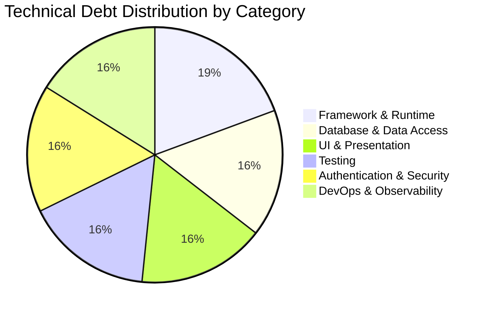
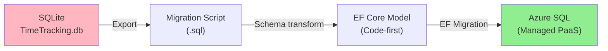
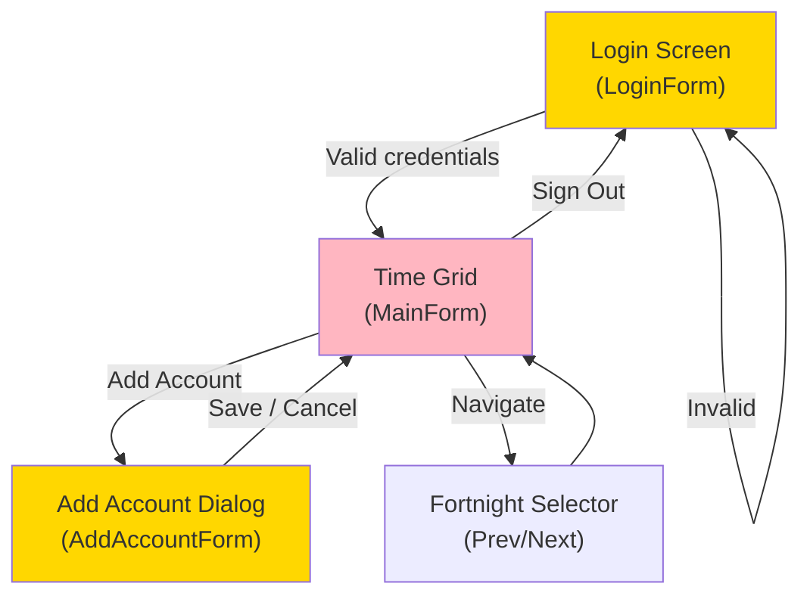
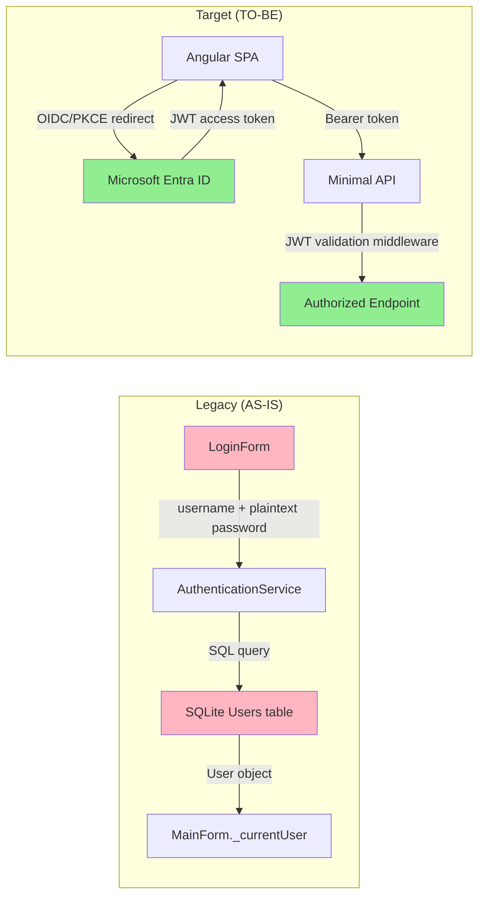
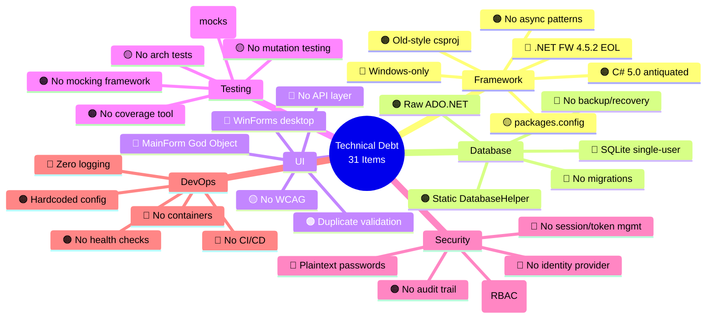
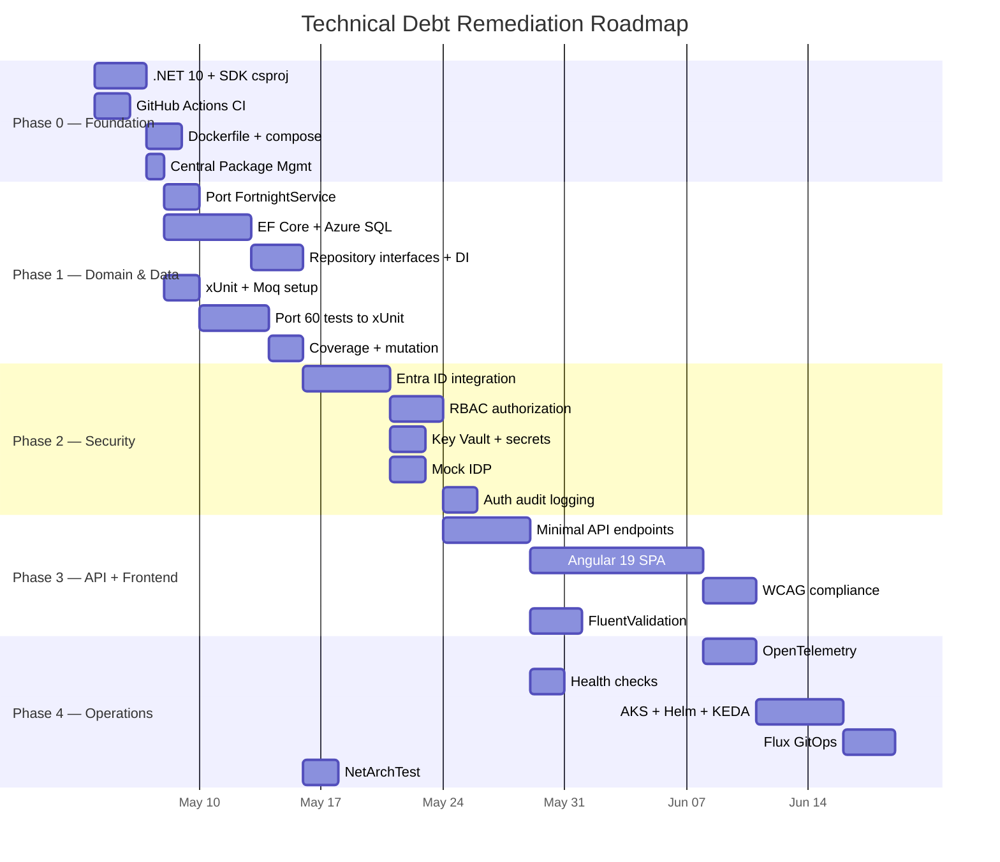

# Technical Debt Report — Legacy TimeTracking

> **Date:** 2026-04-28
> **Project:** TimeTracking (Brownfield Migration)
> **Methodology:** Bolt Framework — DISCOVERY Phase
> **Constitution Reference:** v1.0.0 (2026-03-23)
> **Related:**
> [LEGACY-ANALYSIS.md](LEGACY-ANALYSIS.md) |
> [ARCHITECTURE-PATTERNS-ANALYSIS.md](ARCHITECTURE-PATTERNS-ANALYSIS.md)

---

## Table of Contents

- [Executive Summary](#executive-summary)
- [Debt Score Dashboard](#debt-score-dashboard)
- [TD-01: Framework Obsoleto (.NET FW 4.5.2 → .NET 10)](#td-01-framework-obsoleto-net-fw-452--net-10)
- [TD-02: Base de Datos Local (SQLite → Azure SQL)](#td-02-base-de-datos-local-sqlite--azure-sql)
- [TD-03: UI Desktop (WinForms → Angular SPA)](#td-03-ui-desktop-winforms--angular-spa)
- [TD-04: Testing Framework (NUnit → xUnit)](#td-04-testing-framework-nunit--xunit)
- [TD-05: Autenticación Local → Entra ID](#td-05-autenticación-local--entra-id)
- [TD-06: Sin CI/CD, Sin Contenedores, Sin Observabilidad](#td-06-sin-cicd-sin-contenedores-sin-observabilidad)
- [Consolidated Debt Map](#consolidated-debt-map)
- [Prioritized Remediation Roadmap](#prioritized-remediation-roadmap)
- [Appendix: Debt Item Cross-Reference](#appendix-debt-item-cross-reference)

---

## Executive Summary

The legacy TimeTracking system accumulates **6 major categories of technical debt** spanning
every layer of the stack. Built on **.NET Framework 4.5.2** (EOL since April 2022), it uses a
**SQLite file database**, **WinForms desktop UI**, **NUnit testing without mocks**, **plaintext
password authentication**, and has **zero operational infrastructure** (no CI/CD, no containers,
no observability).

The constitution mandates a modernized stack: **.NET 10**, **Azure SQL**, **Angular 19 SPA**,
**xUnit**, **Entra ID**, **Docker + AKS**, **GitHub Actions**, and **OpenTelemetry**. The
migration strategy defined in Article XVII is **Strangler Fig** (incremental replacement).

### Debt Severity Summary

| Severity | Count | Percentage |
| -------- | ----- | ---------- |
| 🔴 Critical | 18 | 58% |
| 🟠 Major | 9 | 29% |
| 🟡 Minor | 4 | 13% |
| **Total** | **31** | **100%** |

---

## Debt Score Dashboard



| Category | Debt Score (1–10) | Business Risk | Migration Effort |
| --- | --- | --- | --- |
| Framework & Runtime | **9/10** | 🔴 Critical | High |
| Database & Data Access | **8/10** | 🔴 Critical | High |
| UI & Presentation | **9/10** | 🔴 Critical | High |
| Testing | **5/10** | 🟠 Major | Medium |
| Authentication & Security | **10/10** | 🔴 Critical | High |
| DevOps & Observability | **8/10** | 🔴 Critical | High |
| **Weighted Average** | **8.2/10** | | |

---

## TD-01: Framework Obsoleto (.NET FW 4.5.2 → .NET 10)

### Current State (AS-IS)

| Aspect | Value |
| --- | --- |
| Runtime | .NET Framework 4.5.2 |
| Language | C# 5.0 |
| Build system | MSBuild 12.0 (old-style `.csproj`) |
| End of Support | **April 2022** (> 4 years out of support) |
| NuGet management | `packages.config` (legacy format) |
| Target OS | Windows-only |

### Evidence from Codebase

```xml
<!-- TimeTracking.Business.csproj -->
<TargetFrameworkVersion>v4.5.2</TargetFrameworkVersion>
<Project ToolsVersion="12.0" ...>
```

```xml
<!-- TimeTracking.Presentation.csproj -->
<TargetFrameworkVersion>v4.5.2</TargetFrameworkVersion>
<OutputType>WinExe</OutputType>
```

### Debt Items

| ID | Debt Item | Severity | Impact |
| --- | --- | --- | --- |
| TD-01a | .NET FW 4.5.2 end-of-life (no security patches) | 🔴 Critical | Unpatched CVEs, compliance failure |
| TD-01b | C# 5.0 — missing 10 major versions of language features | 🟠 Major | No records, no pattern matching, no nullable refs |
| TD-01c | Old-style `.csproj` format — incompatible with modern tooling | 🟠 Major | No `dotnet` CLI, no Central Package Management |
| TD-01d | `packages.config` — legacy NuGet resolution | 🟡 Minor | Transitive dependency conflicts, no lock file |
| TD-01e | Windows-only deployment — no cross-platform | 🔴 Critical | Cannot run in Linux containers (AKS requires Linux) |
| TD-01f | No `async/await` patterns in service layer | 🟠 Major | Thread pool starvation under load |

### Constitution Target (§2.1)

| Aspect | Target |
| --- | --- |
| Runtime | .NET 10 |
| Language | C# 13+ |
| Build | SDK-style `.csproj` + `Directory.Build.props` |
| NuGet | Central Package Management (`Directory.Packages.props`) |
| API style | Minimal APIs |
| Cross-platform | Linux containers on AKS |

### Missing Modern Features (C# 5 → C# 13)

| Feature | Available Since | Benefit |
| --- | --- | --- |
| `record` types | C# 9 | Immutable DTOs (`FortnightInfo`) |
| Pattern matching | C# 7–11 | Cleaner validation logic |
| Nullable reference types | C# 8 | Eliminate null-return ambiguity |
| File-scoped namespaces | C# 10 | Reduced indentation |
| `required` modifier | C# 11 | Constructor validation |
| Primary constructors | C# 12 | Cleaner DI injection |
| `async/await` improvements | C# 5+ | Scalable I/O |
| Switch expressions | C# 8 | Replace `GetDayOfWeekAbbreviation` switch |
| Top-level statements | C# 9 | Minimal API entry point |
| Collection expressions | C# 12 | Simplified collection init |

### Gap Score: 🔴 9/10

---

## TD-02: Base de Datos Local (SQLite → Azure SQL)

### Current State (AS-IS)

| Aspect | Value |
| --- | --- |
| Database | SQLite 1.0.118 (file-based) |
| Storage | Local file `TimeTracking.db` in app directory |
| Data access | Raw ADO.NET (`System.Data.SQLite`) |
| Connection management | `DatabaseHelper` (static class) |
| Schema management | Manual DDL in `InitializeDatabase()` |
| Migrations | None |
| Multi-user | ❌ File locks prevent concurrent access |
| Backup/Recovery | ❌ None |
| Encryption at rest | ❌ None |

### Evidence from Codebase

```xml
<!-- App.config -->
<appSettings>
  <add key="DatabasePath" value="TimeTracking.db" />
</appSettings>
```

```csharp
// Program.cs — infrastructure leaked into presentation
DatabaseHelper.InitializeDatabase();
DatabaseInitializer.SeedData();
```

```csharp
// Business services — concrete repositories, no interfaces
public ChargeAccountService()
{
    _chargeAccountRepository = new ChargeAccountRepository();  // Hard coupling
}
```

### Debt Items

| ID | Debt Item | Severity | Impact |
| --- | --- | --- | --- |
| TD-02a | SQLite file — no concurrent multi-user access | 🔴 Critical | Cannot scale beyond 1 user |
| TD-02b | No backup/recovery strategy | 🔴 Critical | Data loss on disk failure |
| TD-02c | Raw ADO.NET — manual SQL, no ORM | 🟠 Major | Error-prone, SQL injection risk |
| TD-02d | Static `DatabaseHelper` — untestable, global state | 🟠 Major | Tight coupling, no DI |
| TD-02e | No migrations — schema changes are destructive | 🔴 Critical | Cannot evolve schema safely |

### Constitution Target (§5.1–§5.3)

| Aspect | Target |
| --- | --- |
| Database | Azure SQL Database (managed PaaS) |
| Writes ORM | Entity Framework Core (code-first) |
| Reads ORM | Dapper (CQRS-aligned) |
| Repository | Interface-based (`IRepository<T>`) |
| Unit of Work | Yes |
| Migrations | EF Core Migrations |
| Connection | Managed identity via Key Vault (§10.3) |
| HA/DR | Built-in geo-replication, RPO 1h / RTO 4h (§XIV-D) |
| Encryption | Azure-managed keys at rest, TLS 1.2+ in transit (§16.2) |
| Caching | IMemoryCache (L1) + Redis (L2) (§VI) |

### Data Migration Path



### Gap Score: 🔴 8/10

---

## TD-03: UI Desktop (WinForms → Angular SPA)

### Current State (AS-IS)

| Aspect | Value |
| --- | --- |
| Technology | Windows Forms (.NET FW 4.5.2) |
| Pattern | Code-behind (Smart UI anti-pattern) |
| Forms | 3 forms: `LoginForm`, `MainForm`, `AddAccountForm` |
| God Object | `MainForm` (~350 LOC combining 6 responsibilities) |
| Navigation | `Form.Show()` / `Form.ShowDialog()` |
| Data binding | Manual grid cell manipulation |
| Accessibility | No WCAG compliance |
| Responsive | ❌ Fixed dimensions |
| Deployment | Desktop EXE installation |

### Evidence from Codebase

```csharp
// MainForm.cs — God Object mixing 6 concerns
public MainForm(User user)
{
    _fortnightService = new FortnightService();        // Business orchestration
    _timeEntryService = new TimeEntryService();        // Persistence
    _chargeAccountService = new ChargeAccountService(); // Data retrieval
}

private void SaveCellToDatabase(int rowIndex, string colName, string valueStr)
{
    // 1. Reads UI state (presentation)
    // 2. Parses display format (data transformation)
    // 3. Finds domain entity (business logic)
    // 4. Calls service to persist (infrastructure)
}
```

```csharp
// LoginForm.cs — direct form lifecycle management
this.Hide();
var mainForm = new MainForm(user);
mainForm.FormClosed += (s, args) => this.Close();
mainForm.Show();
```

### Debt Items

| ID | Debt Item | Severity | Impact |
| --- | --- | --- | --- |
| TD-03a | WinForms — Windows-only, desktop deployment | 🔴 Critical | Cannot deploy to web/cloud |
| TD-03b | `MainForm` God Object — 6 responsibilities in 1 class | 🔴 Critical | Unmaintainable, untestable |
| TD-03c | No API layer — UI calls business services directly | 🔴 Critical | Cannot separate client from server |
| TD-03d | Duplicate validation logic (2 handlers, same message) | 🟠 Major | Maintenance burden, inconsistency risk |
| TD-03e | No accessibility (WCAG) compliance | 🟡 Minor | Exclusion of users with disabilities |

### Constitution Target (§2.2, §3.2, Frontend Additions)

| Aspect | Target |
| --- | --- |
| Technology | Angular 19 (standalone components, signals) |
| Component library | PrimeNG 18 (Aura theme) |
| Architecture | Monolith SPA with lazy-loaded feature modules |
| Communication | REST API over HTTP |
| State management | Angular signals |
| Routing | Angular Router with role-based guards |
| Accessibility | WCAG 2.2 AA (axe-core + Playwright audits) |
| Performance | LCP < 2.5s, FID < 100ms, CLS < 0.1 |
| Error tracking | Application Insights JS SDK |
| Testing | Jest/Vitest + Testing Library + Playwright |

### UX Flow Preservation Map

While zero code is reusable, the **user flows** must be preserved:



| Legacy Screen | Angular Route | Components Needed |
| --- | --- | --- |
| `LoginForm` | `/login` | `LoginComponent` (redirects to Entra ID) |
| `MainForm` | `/timesheet` | `TimesheetGridComponent`, `FortnightSelectorComponent` |
| `AddAccountForm` | `/timesheet` (dialog) | `AddAccountDialogComponent` (PrimeNG Dialog) |

### Gap Score: 🔴 9/10

---

## TD-04: Testing Framework (NUnit → xUnit)

### Current State (AS-IS)

| Aspect | Value |
| --- | --- |
| Framework | NUnit 3.13.3 |
| Test adapter | NUnit3TestAdapter 4.4.2 |
| Tests | 60 tests across 4 test classes |
| Test types | Integration only (real SQLite DB per test) |
| Mocking | None |
| Coverage tool | None |
| Mutation testing | None |
| Architecture tests | None |
| BDD/Gherkin | None |
| E2E tests | None |

### Evidence from Codebase

```csharp
// TestBase.cs — every test creates a real database
public abstract class TestBase
{
    [SetUp]
    public void BaseSetUp()
    {
        TestDbPath = Path.Combine(Path.GetTempPath(), Guid.NewGuid() + ".db");
        DatabaseHelper.SetDatabasePath(TestDbPath);
        DatabaseHelper.InitializeDatabase();
        DatabaseInitializer.SeedData();
    }
}
```

```csharp
// NUnit attributes — need migration to xUnit
[TestFixture]
public class AuthenticationServiceTests : TestBase
{
    [SetUp]
    public void SetUp() { ... }

    [Test]
    public void Login_ValidCredentials_ReturnsUser() { ... }
}
```

### NUnit → xUnit Attribute Mapping

| NUnit | xUnit | Notes |
| --- | --- | --- |
| `[TestFixture]` | _(removed)_ | xUnit classes are plain classes |
| `[Test]` | `[Fact]` | Simple test |
| `[TestCase(...)]` | `[Theory]` + `[InlineData]` | Parameterized test |
| `[SetUp]` | Constructor | Instance per test (auto-isolation) |
| `[TearDown]` | `IDisposable` | Deterministic cleanup |
| `Assert.AreEqual(e, a)` | `Assert.Equal(e, a)` | Parameter order same |
| `Assert.IsNull(x)` | `Assert.Null(x)` | Simplified names |
| `Assert.IsTrue(x)` | `Assert.True(x)` | Simplified names |
| `Assert.IsNotNull(x)` | `Assert.NotNull(x)` | Simplified names |
| `Assert.DoesNotThrow(...)` | _(no direct equiv)_ | Just call the method |

### Debt Items

| ID | Debt Item | Severity | Impact |
| --- | --- | --- | --- |
| TD-04a | No unit tests — all tests hit real database | 🟠 Major | Slow tests, false failures |
| TD-04b | No mocking framework — cannot isolate components | 🟠 Major | Cannot test in isolation |
| TD-04c | No code coverage measurement | 🟠 Major | Cannot enforce quality gates |
| TD-04d | No mutation testing | 🟡 Minor | Cannot validate test effectiveness |
| TD-04e | No architecture tests (dependency enforcement) | 🟡 Minor | Layer violations go undetected |

### Constitution Target (§13.1–§13.2)

| Aspect | Target |
| --- | --- |
| Unit tests | xUnit |
| Integration tests | xUnit + Testcontainers |
| Architecture tests | NetArchTest |
| BDD | Reqnroll (Gherkin) |
| E2E | Playwright |
| Performance | k6 |
| Mocking | Moq / NSubstitute |
| Assertions | FluentAssertions |
| Line coverage | ≥ 80% (recommended ≥ 90%) |
| Branch coverage | ≥ 75% (recommended ≥ 85%) |
| Mutation score | ≥ 70% (recommended ≥ 80%) |

### What Survives Migration

The **test logic** (not the framework) is the valuable asset:

| Reusable | Count | Notes |
| --- | --- | --- |
| Test scenarios (logic) | 60 | Business rule test cases port as-is to xUnit |
| Test data patterns | 12 | Seeded data definitions reusable |
| `FortnightServiceTests` | 17 | Zero DB dependency — nearly 1:1 migration |

### Gap Score: 🟠 5/10

---

## TD-05: Autenticación Local → Entra ID

### Current State (AS-IS)

| Aspect | Value |
| --- | --- |
| Authentication | Custom, in-process |
| Password storage | **PLAINTEXT** (no hashing) |
| Identity provider | SQLite `Users` table |
| Session management | Form field (`_currentUser` in `MainForm`) |
| Authorization | None (all users see everything) |
| Token management | None |
| MFA | ❌ None |
| Audit trail | ❌ None |

### Evidence from Codebase

```csharp
// AuthenticationService.cs — plaintext credential lookup
public User Login(string username, string password)
{
    if (string.IsNullOrEmpty(username)) return null;
    if (string.IsNullOrEmpty(password)) return null;
    return _userRepository.GetByCredentials(username, password);  // Plaintext comparison
}
```

```csharp
// LoginForm.cs — session = Form field reference
User user = _authenticationService.Login(username, password);
if (user != null)
{
    var mainForm = new MainForm(user);  // User object passed as session
}
```

### Debt Items

| ID | Debt Item | Severity | Impact |
| --- | --- | --- | --- |
| TD-05a | **Plaintext passwords** — no hashing whatsoever | 🔴 Critical | OWASP A07:2021, credential theft |
| TD-05b | No identity provider — custom user table | 🔴 Critical | No SSO, no federation, no MFA |
| TD-05c | No session management / token-based auth | 🔴 Critical | Session hijacking, no expiry |
| TD-05d | No authorization model (RBAC/ABAC) | 🟠 Major | All users have admin access |
| TD-05e | No audit trail on authentication events | 🟠 Major | Compliance failure, no forensics |

### OWASP Top 10 Violations

| OWASP ID | Vulnerability | Present in Legacy |
| --- | --- | --- |
| A02:2021 | Cryptographic Failures | ✅ Plaintext passwords |
| A04:2021 | Insecure Design | ✅ No threat modeling |
| A07:2021 | Identification & Auth Failures | ✅ No MFA, weak credentials |
| A09:2021 | Security Logging & Monitoring | ✅ Zero logging |

### Constitution Target (§7.1–§7.4)

| Aspect | Target |
| --- | --- |
| Identity Provider | Microsoft Entra ID (Azure AD) |
| Protocol | OIDC / OAuth 2.0 |
| SPA auth flow | Authorization Code + PKCE |
| Service-to-service | Client Credentials |
| API protection | JWT Bearer Validation |
| Authorization | RBAC (role-based) |
| Dev environment | Mock IDP (in-memory, fake tokens) |
| Frontend guards | Angular route guards (role claims) |
| UI visibility | Role-based element display |

### Authentication Migration Flow



### Gap Score: 🔴 10/10

---

## TD-06: Sin CI/CD, Sin Contenedores, Sin Observabilidad

### Current State (AS-IS)

| Aspect | Value |
| --- | --- |
| CI/CD | ❌ None |
| Build automation | Manual MSBuild only |
| Containerization | ❌ None (desktop EXE) |
| Orchestration | ❌ None |
| Observability | ❌ None |
| Logging | ❌ None |
| Health checks | ❌ None |
| Alerting | ❌ None |
| Configuration | `App.config` (hardcoded, unencrypted) |
| Secrets management | ❌ None (DB path in plaintext config) |

### Evidence from Codebase

```xml
<!-- App.config — all configuration is hardcoded -->
<configuration>
  <startup>
    <supportedRuntime version="v4.0" sku=".NETFramework,Version=v4.5.2" />
  </startup>
  <appSettings>
    <add key="DatabasePath" value="TimeTracking.db" />
  </appSettings>
</configuration>
```

No `Dockerfile`, no `docker-compose.yml`, no `.github/workflows/`, no `appsettings.json`,
no `ILogger`, no health check endpoints, no telemetry SDK.

### Debt Items

| ID | Debt Item | Severity | Impact |
| --- | --- | --- | --- |
| TD-06a | No CI/CD pipeline — manual build/deploy only | 🔴 Critical | No automated quality gates |
| TD-06b | No containerization — desktop EXE deployment | 🔴 Critical | Cannot deploy to AKS |
| TD-06c | Zero logging in entire application | 🔴 Critical | No diagnostics, no forensics |
| TD-06d | No health checks | 🟠 Major | Cannot verify app health in production |
| TD-06e | No configuration management (hardcoded `App.config`) | 🟠 Major | No env-specific config, no secrets |

### Constitution Target (§8, §10, §11, §12)

#### CI/CD (§11 — GitHub Actions)

| Stage | Legacy | Target |
| --- | --- | --- |
| Build | ❌ Manual | ✅ Warnings as errors |
| Lint/Format | ❌ None | ✅ `.editorconfig` + `dotnet format` |
| Unit Tests | ❌ Manual NUnit | ✅ xUnit (coverage ≥ 80%) |
| Integration Tests | ❌ None | ✅ Testcontainers |
| Architecture Tests | ❌ None | ✅ NetArchTest |
| Mutation Tests | ❌ None | ✅ Stryker (score ≥ 60%) |
| Security Scan | ❌ None | ✅ 0 Critical |
| Container Build | ❌ None | ✅ Docker |
| Container Scan | ❌ None | ✅ 0 Critical |

#### Containers & Orchestration (§8)

| Aspect | Legacy | Target |
| --- | --- | --- |
| Container runtime | ❌ None | Docker |
| Orchestration | ❌ None | AKS (Azure Kubernetes Service) |
| Package manager | ❌ None | Helm charts |
| Ingress | ❌ None | NGINX Ingress Controller |
| Autoscaling | ❌ None | KEDA (Azure Service Bus scaler) |
| GitOps | ❌ None | Flux (mono-repo pattern) |

#### Observability (§12)

| Aspect | Legacy | Target |
| --- | --- | --- |
| Telemetry SDK | ❌ None | OpenTelemetry |
| Backend | ❌ None | Azure Monitor Exporter |
| Frontend | ❌ None | Application Insights JS SDK |
| Health endpoints | ❌ None | `/health`, `/health/ready`, `/health/live` |
| Dashboards | ❌ None | Azure Workbooks / Grafana |
| Alerts | ❌ None | Azure Monitor Alerts |
| SLOs | ❌ None | 99.9% availability, p95 < 500ms |

#### Configuration (§10)

| Aspect | Legacy | Target |
| --- | --- | --- |
| Config source | `App.config` | Azure App Configuration |
| Secrets | Plaintext in config | Azure Key Vault |
| Local dev secrets | ❌ None | `dotnet user-secrets` |
| Environments | Single (dev) | dev / uat / pre / prod |
| Feature flags | ❌ None | None (per constitution) |

### Gap Score: 🔴 8/10

---

## Consolidated Debt Map



---

## Prioritized Remediation Roadmap

Ordered by **dependency chain** and **risk reduction**:

### Phase 0 — Foundation (Weeks 1–2)

> Unblocks all subsequent phases.

| Action | Debt Resolved | Rationale |
| --- | --- | --- |
| Create .NET 10 solution with SDK-style `.csproj` | TD-01a,b,c,d | Modern runtime enables everything |
| Set up `Directory.Build.props` + `Directory.Packages.props` | TD-01c,d | Centralized package management |
| Create GitHub Actions CI pipeline (build + lint) | TD-06a | Automated quality from day 1 |
| Add `Dockerfile` + `docker-compose.yml` | TD-06b | Enables AKS deployment path |

### Phase 1 — Domain & Data (Weeks 3–5)

> Establish Clean Architecture core and database.

| Action | Debt Resolved | Rationale |
| --- | --- | --- |
| Port `FortnightService` + `FortnightInfo` as-is | TD-01a | Zero-dependency, direct reuse |
| Create EF Core model + Azure SQL migrations | TD-02a,b,c,e | Proper data layer foundation |
| Define repository interfaces + DI registration | TD-02d | Enable testability |
| Set up xUnit + FluentAssertions + Moq | TD-04a,b | Unit test infrastructure |
| Port 60 test scenarios from NUnit to xUnit | TD-04a | Preserve test knowledge |
| Add code coverage (Coverlet) + mutation (Stryker) | TD-04c,d | Quality gate metrics |

### Phase 2 — Security (Weeks 6–7)

> Eliminate critical security debt.

| Action | Debt Resolved | Rationale |
| --- | --- | --- |
| Integrate Microsoft Entra ID (OIDC/PKCE) | TD-05a,b,c | Eliminate plaintext passwords |
| Implement RBAC authorization model | TD-05d | Enforce least privilege |
| Add Azure Key Vault for secrets | TD-06e | Secure configuration |
| Set up Mock IDP for dev/test | TD-05a | Developer experience |
| Add authentication audit logging | TD-05e | Compliance requirement |

### Phase 3 — API + Frontend (Weeks 8–12)

> Build the user-facing layers.

| Action | Debt Resolved | Rationale |
| --- | --- | --- |
| Create Minimal API endpoints (REST) | TD-03c | Client-server separation |
| Build Angular 19 SPA (PrimeNG) | TD-03a,b | Modern web UI |
| Implement WCAG 2.2 AA compliance | TD-03e | Accessibility |
| Add Angular route guards (RBAC) | TD-05d | Frontend authorization |
| Port validation to FluentValidation | TD-03d | Single source of truth |

### Phase 4 — Operations (Weeks 13–15)

> Production readiness.

| Action | Debt Resolved | Rationale |
| --- | --- | --- |
| Add OpenTelemetry instrumentation | TD-06c | Observability |
| Implement health check endpoints | TD-06d | Kubernetes probes |
| Set up Azure Monitor + Grafana dashboards | TD-06c | Monitoring |
| Configure AKS + Helm + KEDA | TD-06b | Production orchestration |
| Add Flux GitOps | TD-06a | Continuous deployment |
| Add NetArchTest for dependency enforcement | TD-04e | Prevent architecture erosion |
| Set up Azure App Configuration | TD-06e | Environment-specific config |

### Phase Timeline



---

## Appendix: Debt Item Cross-Reference

| ID | Debt Item | Category | Severity | Phase | Constitution §§ |
| --- | --- | --- | --- | --- | --- |
| TD-01a | .NET FW 4.5.2 EOL | Framework | 🔴 | 0 | §2.1 |
| TD-01b | C# 5.0 antiquated | Framework | 🟠 | 0 | §2.1 |
| TD-01c | Old-style `.csproj` | Framework | 🟠 | 0 | §15.1 |
| TD-01d | `packages.config` legacy | Framework | 🟡 | 0 | §15.1 |
| TD-01e | Windows-only (no containers) | Framework | 🔴 | 0 | §8.1 |
| TD-01f | No `async/await` in services | Framework | 🟠 | 1 | §2.1 |
| TD-02a | SQLite single-user | Database | 🔴 | 1 | §5.1 |
| TD-02b | No backup/recovery | Database | 🔴 | 1 | §XIV-D |
| TD-02c | Raw ADO.NET | Database | 🟠 | 1 | §5.2 |
| TD-02d | Static `DatabaseHelper` | Database | 🟠 | 1 | §5.2 |
| TD-02e | No schema migrations | Database | 🔴 | 1 | §5.3 |
| TD-03a | WinForms desktop-only | UI | 🔴 | 3 | §2.2 |
| TD-03b | `MainForm` God Object | UI | 🔴 | 3 | §3.2 |
| TD-03c | No API layer | UI | 🔴 | 3 | §2.1, §18 |
| TD-03d | Duplicate validation | UI | 🟠 | 3 | §14.1 |
| TD-03e | No WCAG compliance | UI | 🟡 | 3 | Frontend §A11y |
| TD-04a | No unit tests (only integration) | Testing | 🟠 | 1 | §13.1 |
| TD-04b | No mocking framework | Testing | 🟠 | 1 | §13.2 |
| TD-04c | No code coverage tool | Testing | 🟠 | 1 | §13.1 |
| TD-04d | No mutation testing | Testing | 🟡 | 1 | §13.1 |
| TD-04e | No architecture tests | Testing | 🟡 | 4 | §13.2 |
| TD-05a | Plaintext passwords | Security | 🔴 | 2 | §7.1, §16.2 |
| TD-05b | No identity provider | Security | 🔴 | 2 | §7.1 |
| TD-05c | No session/token management | Security | 🔴 | 2 | §7.3 |
| TD-05d | No authorization (RBAC) | Security | 🟠 | 2 | §7.4 |
| TD-05e | No audit trail | Security | 🟠 | 2 | §12.1 |
| TD-06a | No CI/CD pipeline | DevOps | 🔴 | 0 | §11 |
| TD-06b | No containerization | DevOps | 🔴 | 0 | §8.1 |
| TD-06c | Zero logging/observability | DevOps | 🔴 | 4 | §12.1 |
| TD-06d | No health checks | DevOps | 🟠 | 4 | §12 Health |
| TD-06e | Hardcoded `App.config` | DevOps | 🟠 | 2 | §10.2, §10.3 |
